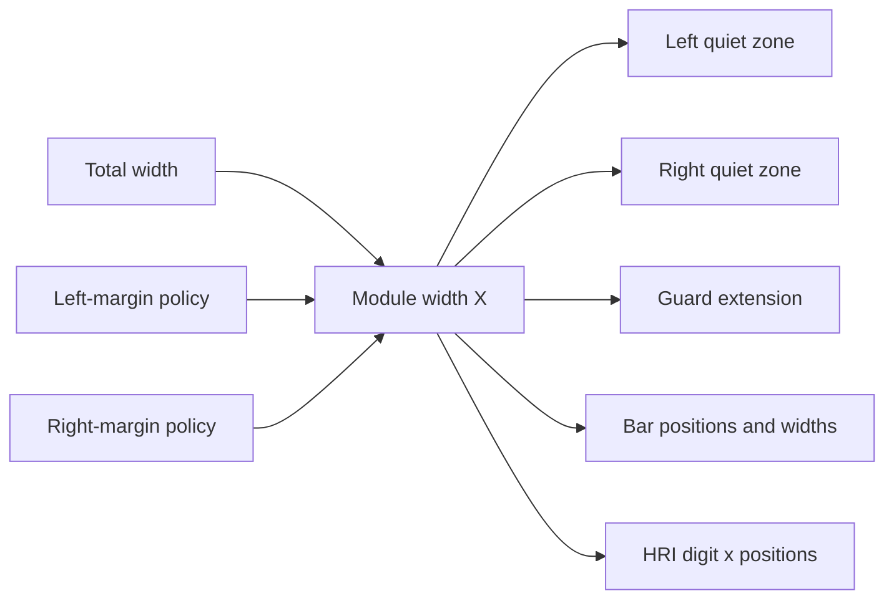

# BookBarcode Trial Analysis

## Purpose

This document records lessons from using BookBarcode as a trial case for the
graph-analysis capabilities in `agent-tools`. The trial focuses on a domain in
which physical measurements form an explicit dependency system: page size,
quiet zones, EAN module width, bar geometry, guard extensions, text placement,
and vertical-fit constraints.

The goal is not to redesign BookBarcode here. The goal is to identify what the
current graph tools can already reveal, what they cannot represent, and which
improvements would make them more useful for domain dependency analysis,
testing, documentation, and low-context agent workflows.

## Trial Domain

EAN-13 layout is naturally described as a directed acyclic graph (DAG). One
module, conventionally called `X`, is the narrowest horizontal bar/space unit.
The encoded symbol is 95 modules wide. Other measurements depend on `X` or on
the requested artifact dimensions.

An abbreviated domain graph is:



The graph also contains constraints that are not ordinary derivation edges:

```text
left quiet zone  >= 11X
right quiet zone >= 7X
guard-bar bottom < HRI baseline
```

This distinction is important. A domain graph needs to express at least:

* **derivation** — one value is calculated from upstream values;
* **constraint** — values must satisfy a relation but neither necessarily
  produces the other;
* **source selection** — an explicit value overrides or replaces a derived
  default;
* **provenance** — a resolved value came from a preset, caller input, fallback,
  or calculation.

## Current Agent-tools Capabilities

### `semantic_dfg`

`semantic_dfg` is the closest existing tool to the trial's needs. It can expose
local value dependencies such as:

```text
available_width -> module_width
module_width -> minimum_left
module_width -> guard_extension
```

A trial run against BookBarcode's `bookbarcode/layout.py` succeeded and
produced 15 function graphs, 58 nodes, 57 edges, and 29 warnings. It correctly
identified the local flow from `module_width` to the minimum left and right
quiet-zone values.

The same run also demonstrated the current limits:

* analysis is local to one function;
* property and method dependencies are not joined across scopes;
* attribute reads such as `self.width_mm` often collapse into a dependency on
  `self`, losing field-level precision;
* conditional paths are only partially modeled;
* `raise` statements are not analyzed;
* domain constraints are not represented as first-class edges;
* no domain-level DAG is reconstructed from related functions and properties.

### `semantic_cfg`

`semantic_cfg` can describe control paths in fallback and validation logic. For
example, it can show the alternatives in a margin policy:

```text
explicit side margin
  or shared side margin
  or standard-derived quiet zone
```

This is useful for identifying branches that need tests. It does not prove
numeric constraints such as `left_quiet_zone >= 11X`.

### `semantic_ast` Call Graph

The call graph can verify architectural flow after a resolver-based design is
implemented. It can help detect cases in which:

* a renderer bypasses the shared geometry layer;
* an adapter reimplements domain calculations;
* SVG and PDF follow different computation paths;
* a supposedly independent verifier imports or calls renderer logic.

It exposes function relationships, not measurement dependencies.

### `semantic_cpg`

`semantic_cpg` provides a unified surface over AST, CFG, DFG, and call-graph
results. It is a promising integration layer for future projections, but it
does not currently add the missing domain semantics. For a small repository it
is likely too broad to use as a mandatory quality gate until the underlying
field-level and interprocedural relations improve.

### `semantic_cards` and Projection Layers

Graph-friendly cards can help an agent navigate the implementation and connect
domain concepts to source locations. They are useful as a presentation layer,
provided that the underlying domain graph remains separate from inferred code
structure.

## Main Gaps Revealed by the Trial

### 1. Field-level attribute dependencies

The DFG should distinguish dependencies on individual fields:

```text
self.width_mm
self.left_margin_mm
self.right_margin_mm
```

Treating all of these as `self` hides the measurement graph and makes impact
analysis imprecise.

Possible improvement:

* add stable attribute nodes;
* preserve receiver and attribute identity;
* distinguish reads from writes;
* retain source locations and scope provenance.

### 2. Interprocedural property and method flow

BookBarcode distributes relationships across properties and helper methods.
For example, a quiet-zone validator reads a module-width property that itself
depends on effective-margin properties.

The toolchain needs an optional bounded interprocedural projection that can
connect:

```text
input field
  -> property
  -> helper binding
  -> resolved field
  -> constraint
```

This should remain deterministic and conservative. Unresolved dynamic calls
should be reported rather than guessed.

### 3. First-class constraint relations

Existing DFG edges describe production and value dependency. Domain analysis
also needs constraints such as:

```text
greater_than_or_equal
less_than
fits_before
equals_multiple_of
```

Suggested edge shape:

```json
{
  "source": "resolved:left_quiet_zone_mm",
  "target": "resolved:module_width_mm",
  "kind": "constrained_by",
  "relation": "greater_than_or_equal_multiple",
  "factor": 11,
  "lineno": 142
}
```

The tool should not attempt to prove arbitrary mathematics initially. A useful
first step is faithful extraction and explicit uncertainty.

### 4. Source-selection and fallback semantics

Resolved values may have alternative authorities:

```text
explicit left margin
  else shared margin
  else 11X fallback
```

This is neither a plain control-flow edge nor a plain data dependency. It would
be useful to represent:

* precedence order;
* selected source;
* fallback source;
* mutually exclusive alternatives;
* the conditions under which an edge is active.

### 5. Domain graph versus inferred code graph

An inferred code graph answers “what does this implementation currently do?”
A hand-authored domain graph answers “what must every valid implementation
preserve?” These must not be treated as the same source of truth.

Agent-tools currently lacks a small contract format for a declared domain DAG.
A future format could support:

* typed nodes (`input`, `derived`, `constraint`, `output`);
* typed edges (`depends_on`, `constrained_by`, `overrides`);
* units;
* formulas or human-readable rules;
* topological order;
* source-code references;
* test references;
* documentation projections.

### 6. Comparison between declared and inferred graphs

The most valuable future capability may be a graph conformance check:

```text
declared domain DAG
        versus
AST/DFG/CFG/call-graph evidence
```

Potential findings include:

* a declared dependency is not visible in the implementation;
* code introduces an undocumented dependency;
* a renderer bypasses a required layer;
* a constraint has no corresponding test;
* a resolved output has no traceable input provenance;
* a cycle appears in a graph intended to be acyclic.

This comparison should report evidence and uncertainty, not claim formal proof.

## Opportunities for Analysis

### Impact analysis

Given a node such as `module_width_mm`, report downstream effects:

```text
quiet zones
guard extension
bar positions
bar widths
HRI positions
serialized SVG/PDF coordinates
```

### Cycle detection

If a future API accepts both total width and module width as authorities, a
dependency cycle or overspecified system may appear. Graph validation should
detect cycles and identify the responsible edges.

### Topological resolution audit

A declared topological order can be compared with implementation flow:

```text
1. select base dimensions
2. select margin sources
3. resolve module width
4. resolve and validate quiet zones
5. resolve horizontal geometry
6. resolve vertical geometry
7. validate fit constraints
8. emit an immutable resolved layout
```

### Boundary and ownership audit

Call-graph and CPG projections can verify that package, adapter, geometry,
renderer, and verifier boundaries remain intentional.

## Opportunities for Testing

### Graph-derived test inventory

Each source-selection branch and constraint can produce a suggested test case:

* explicit left/right margins;
* shared margin fallback;
* standard quiet-zone fallback;
* exact `11X` and `7X` boundaries;
* values immediately below each boundary;
* custom bar height versus proportional fallback;
* vertical geometry that fits exactly or fails clearly.

The tool should generate a test inventory or test skeletons, not silently write
tests unless explicitly authorized.

### Dependency mutation checks

A future analysis could identify which assertions should fail when a formula is
mutated. For example, changing `GUARD_EXTENSION_MODULES` should affect guard
height tests but not ISBN encoding tests.

### Architecture regression checks

Call-graph assertions could detect direct renderer-to-input coupling or adapter
reimplementation. Such checks should be narrow and stable rather than snapshots
of an entire large graph.

### Declared-graph validation

If a domain DAG format is introduced, its own validator should check:

* unique node identifiers;
* valid edge endpoints;
* supported units and relation kinds;
* acyclicity of derivation edges;
* topological ordering;
* separation of constraints from derivations;
* resolvability of required outputs;
* stale source and test references.

## Opportunities for Documentation

### Canonical Mermaid projection

A declared DAG could generate a deterministic Mermaid diagram for maintainers
and LLM context. Derivation and constraint edges should use visibly different
styles and include a legend.

### Compact agent context

An LLM-oriented projection should answer, in a small token budget:

* which values are caller inputs;
* which values are derived;
* which constraints are mandatory;
* what changes downstream when one input changes;
* which module owns each calculation;
* which tests protect each rule.

### Human-readable dependency tables

The same graph could generate tables containing node, unit, formula, upstream
dependencies, constraints, code owner, and test evidence. This may be easier to
review than a large visual graph.

### Drift detection

Generated documentation should be reproducible. CI could regenerate a
projection and fail when checked-in documentation no longer matches the
declared graph. It should not treat an AST-inferred graph as canonical domain
truth.

## Recommended Development Direction

### Phase 1 — Improve `semantic_dfg`

1. Preserve field-level attribute nodes.
2. Improve expressions involving property reads.
3. Model `raise` as a terminal or validation outcome.
4. Improve conditional edge provenance.
5. Add concise summaries suited to small models.

### Phase 2 — Add bounded interprocedural projection

1. Join local property/method calls when statically resolvable.
2. Preserve unresolved-call warnings.
3. Make depth and node limits explicit.
4. Avoid runtime tracing and speculative dynamic resolution.

### Phase 3 — Define a domain dependency graph contract

1. Specify node and edge kinds.
2. Separate derivation, constraint, and source-selection edges.
3. Require units and stable identifiers.
4. Define acyclicity rules only for derivation edges.
5. Include optional code, documentation, and test references.

This may begin as a schema and validator rather than a large new tool.

### Phase 4 — Add projections and conformance reports

1. Mermaid documentation projection.
2. Compact LLM-context projection.
3. Test inventory projection.
4. Declared-versus-inferred graph comparison.
5. Focused architecture regression checks.

## Suggested Acceptance Criteria

A future trial should be able to:

1. represent the BookBarcode measurement DAG without ambiguous `self` nodes;
2. distinguish formulas from constraints and fallbacks;
3. reject cycles among derivation edges;
4. produce a deterministic topological ordering;
5. generate a readable Mermaid graph and compact text summary;
6. link every mandatory constraint to implementation and test evidence;
7. show downstream impact for a selected measurement;
8. report unresolved or uncertain implementation links honestly;
9. run without modifying the analyzed repository;
10. remain useful to both large reasoning models and smaller local models.

## Recommended Role of Each Existing Tool

```text
semantic_ast / call_graph
    architectural call relationships

semantic_cfg
    branches, fallbacks, and validation paths

semantic_dfg
    local value dependencies and flow levels

semantic_cpg
    unified evidence surface

semantic_cards / projections
    human and agent navigation

future domain-DAG schema and validator
    declared domain truth, topology, constraints, and documentation
```

The existing tools should serve as evidence and analysis layers. A declared
domain DAG should remain the authoritative statement of mandatory measurement
relationships.

## Risks and Design Cautions

* Do not turn the runtime into a generic graph engine merely to solve a small
  static-resolution problem.
* Do not weaken Python typing by moving formulas into unstructured string maps.
* Do not treat inferred implementation graphs as proof of domain correctness.
* Do not make experimental whole-graph snapshots mandatory CI gates; prefer
  stable, focused assertions.
* Do not let renderers and verifiers share the same formula implementation when
  independent verification is a safety property.
* Do not generate visually impressive graphs before node identity, edge
  semantics, provenance, and uncertainty are reliable.

## Proposed Next Trial

After BookBarcode adopts a typed flow such as:

```text
LayoutSpec
  -> LayoutResolver
  -> ResolvedBarcodeLayout
  -> BarcodeGeometry
  -> SVG/PDF renderers
```

repeat the tool analysis and compare it with this trial. The next trial should
measure whether:

* field-level dependencies are more visible;
* local DFG warnings decrease;
* the call graph reflects intended ownership boundaries;
* constraints map cleanly to tests;
* an LLM can explain the measurement system from compact graph context without
  reading the full implementation.

